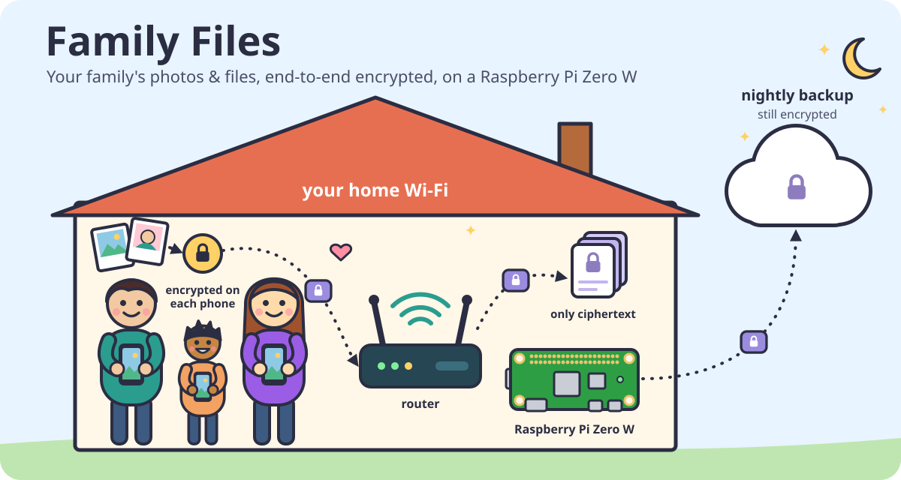

# Family Files: an encrypted family file share on a Raspberry Pi Zero W

<p align="center"></p>

Turn a Raspberry Pi Zero W and a microSD card into a private shared drive for your family. Everyone on your home Wi-Fi opens a web page, types the family password, and can upload, browse, preview, move and delete photos and files. Nothing to install on phones or laptops: it is just a website on your network.

Everything is **end-to-end encrypted**: each phone or laptop encrypts files *before* uploading them, so the Pi only ever stores ciphertext. That includes file names, folder names and thumbnails. If someone takes the Pi or its SD card, or gets hold of your backup, they get noise.

- **Made for the Pi Zero W**: the board costs about €15, draws about 1 W, and runs silently all day. It also runs on a Pi Zero 2 W or any other Pi.
- **No dependencies**: Node.js standard library on the Pi, Web Crypto in the browser. There is no `npm install`.
- **Features**: photo thumbnails and previews, folders, a disk usage bar, and an optional nightly backup to Google Drive (ciphertext only).

> **Using an AI coding agent?** This repo ships a setup skill at [`.claude/skills/pi-setup`](.claude/skills/pi-setup/SKILL.md). Clone the repo, open it in Claude Code (or another agent that reads `SKILL.md` skills), and say *"set up Family Files on my Pi"*. The agent runs the commands over SSH and tells you whenever it needs your hands: flashing the card, router settings, typing passwords. It also includes one-time boot scripts that diagnose or fix a Pi that won't get online.

---

## 1. What to buy

| Item | Notes |
|---|---|
| **Raspberry Pi Zero W** (or Zero WH, Zero 2 W) | The "W" matters: it has Wi-Fi. A plain Pi Zero has no networking. |
| **microSD card, 32 GB or more**, class A1 or A2 | This is your family's storage, so size it accordingly. 128 GB is a good start. |
| **5 V / 2.5 A micro-USB power supply** | Use a proper wall adapter. Power banks and laptop ports often can't deliver enough current, and the Pi reboots or drops off Wi-Fi. |
| A case (optional) | |
| A microSD card reader for your computer | Only needed once, for flashing. |

You don't need a monitor, keyboard or HDMI cable. The Pi is set up entirely over Wi-Fi ("headless").

**Wi-Fi requirements:** the Pi Zero W only supports **2.4 GHz** Wi-Fi with **WPA2**. If your router uses WPA3-only or 5 GHz-only, enable a WPA2 2.4 GHz network, or a "WPA2/WPA3" mixed mode.

## 2. Flash the SD card

1. Install **Raspberry Pi Imager** on your computer from https://www.raspberrypi.com/software/
2. Choose the device, operating system and card:
   - **Device:** Raspberry Pi Zero
   - **OS:** Raspberry Pi OS (other) → **Raspberry Pi OS Lite (32-bit)**. Lite means there is no desktop, which is what you want.
   - **Storage:** your microSD card
3. When Imager asks about OS customisation, choose **Edit settings** and fill in:
   - **Hostname:** for example `familyfiles`
   - **Username and password:** your own, for SSH
   - **Wireless LAN:** your Wi-Fi name and password, and your country
   - **Locale:** your timezone. The nightly backup runs at night by this clock.
   - **Services:** enable **SSH**. Prefer *public-key authentication* and paste your public key (`cat ~/.ssh/id_ed25519.pub`; create one with `ssh-keygen -t ed25519` if you have none).
4. Write the card, put it in the Pi, and plug in the power.

The first boot takes a few minutes on a Zero W, because it resizes the card and applies your settings. Wait about 5 minutes before going further.

## 3. Connect and update

```sh
ssh <your-user>@familyfiles.local
sudo apt update && sudo apt full-upgrade -y     # slow on a Zero W; let it run
sudo reboot
```

If `familyfiles.local` doesn't resolve, look up the Pi's IP address in your router's device list and use that instead.

## 4. Install Family Files

```sh
sudo apt install -y nodejs git          # Node.js 20 from Raspberry Pi OS; works on the Zero W's ARMv6 CPU
git clone https://github.com/apotox/family-files.git ~/family-files
cd ~/family-files
npm test                                # self-check, takes about 40 s on a Zero W, prints "ok"
```

> Use the `nodejs` package from apt. Official Node.js builds, nvm and NodeSource no longer support the Zero W's ARMv6 CPU.

Set the family password. Choose a **long passphrase**, because it is the key to everything. It can't be changed once files exist: a new password would mean a new key, and every existing file would become unreadable.

```sh
read -rs P && printf '%s' "$P" | node server.js set-password; unset P
```

## 5. HTTPS

Browsers only allow encryption (Web Crypto) on secure pages. So outside `localhost`, the site **must** be served over HTTPS with a certificate the browser trusts.

The free way that works on a home network is:

1. Use a domain you own, with its DNS at Cloudflare. Any cheap domain works.
2. Give the Pi a name in that domain that points at its LAN IP address.
3. Get a Let's Encrypt certificate through a DNS challenge. Nothing is exposed to the internet.

1. **Fix the Pi's IP address** in your router (a DHCP reservation, often called "always assign this IP address"), so it doesn't change.
2. **In Cloudflare DNS, add an A record**, for example `files.example.com` → `192.168.1.50` (the Pi's IP), with the proxy set to **DNS only** (grey cloud).
3. **Allow it in your router:** many routers block public names that point at private IP addresses ("DNS rebind protection"). Add an exception for `files.example.com`. FRITZ!Box, Speedport and others all have this setting.
4. **Create a Cloudflare API token:** My Profile → API Tokens → *Edit zone DNS* template, limited to just this domain.
5. **Get the certificate on the Pi:**

```sh
sudo apt install -y acme.sh
export CF_Token='your-cloudflare-token'
acme.sh --home ~/.acme.sh --issue --dns dns_cf -d files.example.com --server letsencrypt
mkdir -p ~/family-files/certs
acme.sh --home ~/.acme.sh --install-cert -d files.example.com \
  --fullchain-file ~/family-files/certs/fullchain.pem --key-file ~/family-files/certs/key.pem
(crontab -l 2>/dev/null; echo '17 3 * * * /usr/bin/acme.sh --cron --home $HOME/.acme.sh > /dev/null') | crontab -
```

The renewal job runs every night and renews the certificate when it is due. The app re-reads its certificate twice a day, so no restart is needed after a renewal.

## 6. Run it as a service

This starts Family Files on boot, restarts it if it crashes, and lets it use port 443 without running as root:

```sh
sudo tee /etc/systemd/system/family-files.service > /dev/null <<EOF
[Unit]
Description=Family Files
After=network-online.target
Wants=network-online.target

[Service]
User=$USER
WorkingDirectory=$HOME/family-files
Environment=PORT=443 TLS_CERT=$HOME/family-files/certs/fullchain.pem TLS_KEY=$HOME/family-files/certs/key.pem
ExecStart=/usr/bin/node server.js
Restart=always
AmbientCapabilities=CAP_NET_BIND_SERVICE

[Install]
WantedBy=multi-user.target
EOF
sudo systemctl enable --now family-files
systemctl status family-files --no-pager
```

Open **https://files.example.com** on any device on your Wi-Fi, enter the family password, and add the page to your home screen.

## 7. Nightly backup to Google Drive (optional)

`backup.sh` mirrors the encrypted store to Google Drive using rclone. Google only ever sees ciphertext. Files deleted or replaced in the app are kept in `deleted/<date>` on Drive, so a mistake in the app doesn't also erase them from the backup.

1. Install rclone on the Pi:
   ```sh
   sudo apt install -y rclone
   ```
2. Authorise Google Drive. The Pi has no browser, so forward rclone's sign-in page to your computer: run this **on your computer**, then open the link it prints.
   ```sh
   ssh -L 53682:127.0.0.1:53682 <your-user>@familyfiles.local \
     'rclone authorize drive eyJzY29wZSI6ImRyaXZlLmZpbGUifQ --auth-no-open-browser'
   ```
   The long argument requests the narrow `drive.file` scope, which lets rclone see only the files it creates in your Drive.
3. Step 2 prints a long code between `--->` and `<---`. That code is your Drive access token, so keep it private. Create the remote on the Pi with it. Using `read -rs` keeps the code out of your shell history:
   ```sh
   read -rs B    # paste the code, press Enter
   rclone config create gdrive drive scope=drive.file --non-interactive \
     token="$(node -p 'JSON.parse(Buffer.from(process.argv[1], "base64url")).token' "$B")" > /dev/null; unset B
   rclone lsd gdrive:    # no error means it's connected
   ```
4. Schedule the backup and run it once to check that it works:
   ```sh
   (crontab -l; echo "30 2 * * * flock -n /tmp/family-backup.lock $HOME/family-files/backup.sh") | crontab -
   ~/family-files/backup.sh && rclone size gdrive:FamilyFilesBackup/current
   ```

**To restore** onto a fresh Pi, run `rclone copy gdrive:FamilyFilesBackup/current ~/family-files/data`, then log in with the same family password.

## Updating

```sh
cd ~/family-files && git pull && sudo systemctl restart family-files
```

## Troubleshooting

| Symptom | Likely cause |
|---|---|
| Pi never shows up on the network | **Power first:** use a proper 2.5 A adapter. Then check that the Wi-Fi is 2.4 GHz and WPA2 (not WPA3-only), and that the country is set in Imager. |
| Pi joins, then disappears or reboots | **Undervoltage.** Check with `vcgencmd get_throttled`; any value other than `0x0` means the power supply is too weak. |
| Pi shows in the router but never gets online | On some Raspberry Pi OS (trixie) images, the Imager Wi-Fi settings don't produce a working connection profile. If you can get a shell (temporarily over Ethernet with a USB adapter, or via a one-time boot script on the card), run `sudo nmcli dev wifi connect '<ssid>' password '<password>'` once; the setting persists. |
| Page says "must be opened over https" | You opened it via the IP address or `http://`. Use the `https://files.example.com` name. |
| `files.example.com` doesn't resolve at home | Your router's DNS rebind protection blocks it; add the exception (step 5.3). |
| "Wrong password" | Passwords are case-sensitive and are checked exactly. There is no reset: the password *is* the key. |

---

## How the encryption works

```
password ──PBKDF2-SHA256 (600k, per-install salt)──► master ──HKDF──┬─► AES-256-GCM key (stays in the browser)
                                                                    └─► login token (sent to the Pi)
```

- **What the Pi keeps from the password:** only `SHA-256(token)`. It can check a login, but it cannot derive the encryption key. The slow PBKDF2 step runs on the phone or laptop, not on the Pi.
- **How files are encrypted:** in 4 MiB chunks with AES-256-GCM.
  - Each chunk's IV is a random 8-byte per-file prefix followed by the chunk index.
  - The file id and a "last chunk" flag are bound in as additional authenticated data (AAD).
  - As a result, reordering, swapping chunks between files, or truncating a file all fail to decrypt.
- **What else is encrypted:** the name, type, size, folder and thumbnail, stored together as one encrypted metadata blob per file.
- **Where the key lives:** after login it is kept in IndexedDB as a *non-extractable* `CryptoKey`. Not even scripts on the page can read the raw key.

### What this does not protect against

- **Someone who takes control of the running Pi can change the web page it serves** and capture the password at the next login. This applies to any web app that encrypts in the browser. The encryption protects stored data (a stolen card, the backup), not a live, compromised server. Keep the Pi updated and don't expose it to the internet.
- **The Pi still sees some information:** how many files there are, their approximate sizes, upload times and which device uploaded.
- **Everyone shares one password and has the same rights.** Anyone in the family can delete anything (deleted files stay in the backup).
- **Password strength is the whole defence if the stored data leaks**, because an attacker can guess passwords offline. Use a long passphrase.

## Configuration

| Environment variable | Default | Meaning |
|---|---|---|
| `PORT` | `3000` | Port to listen on |
| `DATA_DIR` | `./data` | Encrypted files and `config.json` (salt and verifier) |
| `TLS_CERT`, `TLS_KEY` | unset | Serve HTTPS with this certificate and key |

To try it on your computer without a Pi, run `node server.js` and open http://localhost:3000. `localhost` counts as secure, so no certificate is needed.

## API

All endpoints except `/api/salt` require `Authorization: Bearer <token>`. Bodies are ciphertext.

| Method and path | Purpose |
|---|---|
| `GET /api/salt` | Returns the salt the browser needs to derive the key and token |
| `GET /api/files` | Lists files as `[{ id, meta, created }]`; `meta` is encrypted |
| `GET /api/disk` | Returns `{ used, free }` in bytes |
| `PUT /api/files/:id/:i` | Uploads chunk `i`; chunks must arrive in order |
| `POST /api/files/:id` | Saves the encrypted metadata. The first call completes the upload; later calls replace it (moving) |
| `GET /api/files/:id/:i` | Downloads chunk `i` |
| `DELETE /api/files/:id` | Deletes the file |
